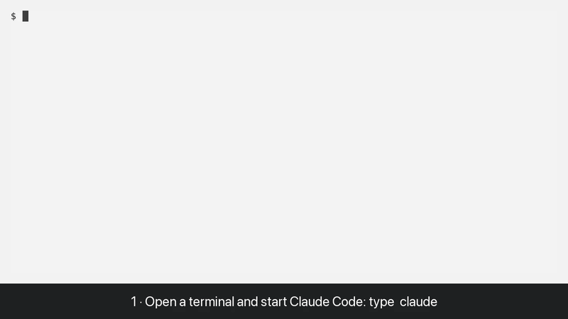
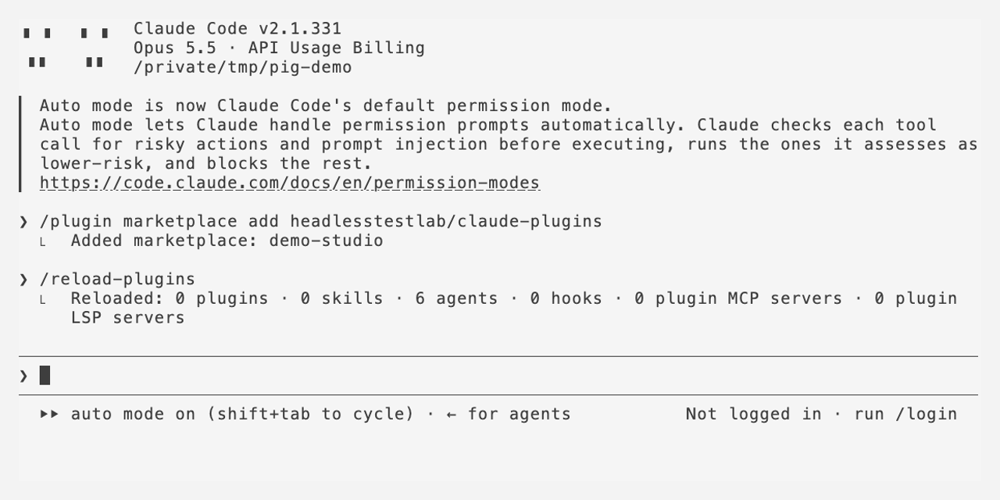
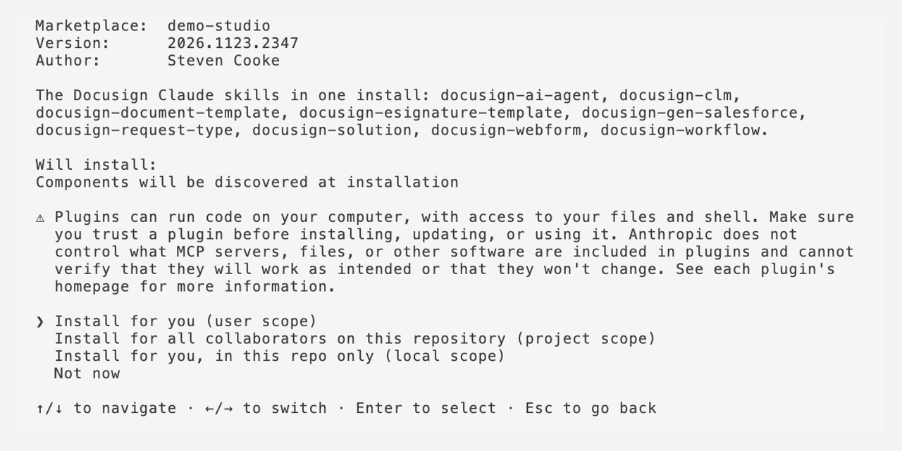
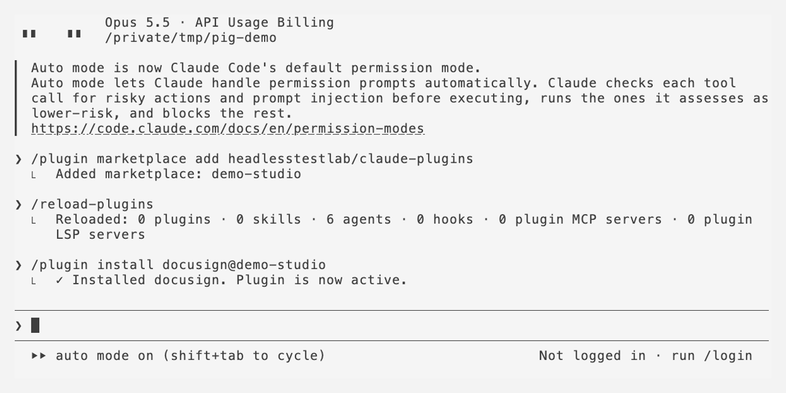
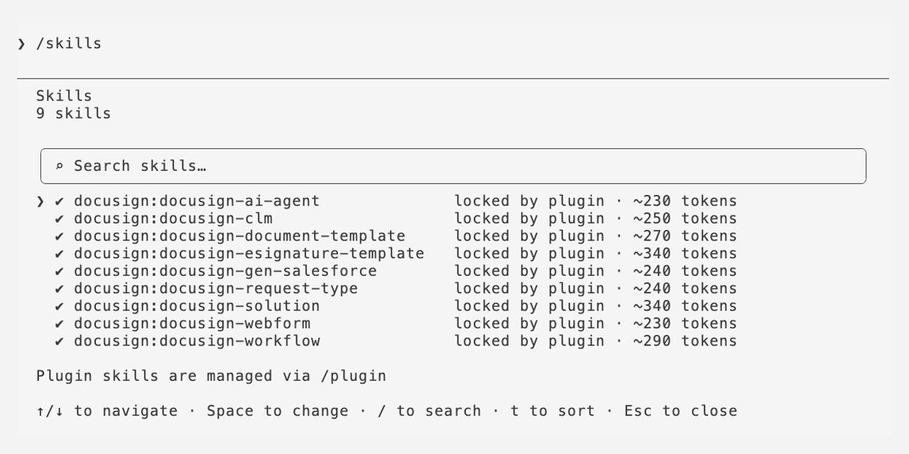
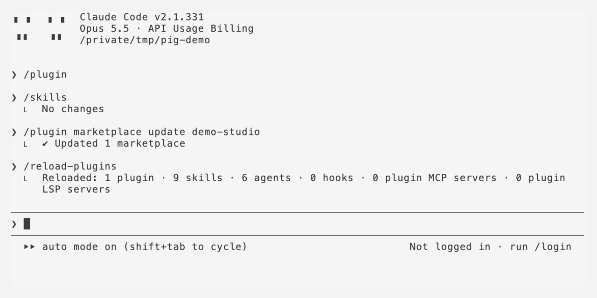

# Docusign demo skills for Claude Code

A Claude Code plugin marketplace, `demo-studio`, with one plugin, `docusign`: Claude skills that design and
build Docusign demo assets (eSignature and document templates, web forms, Maestro workflows, CLM, AI agents and more)
from a plain-language request. Each skill loads when a request matches its description.

Skills: `docusign-ai-agent`, `docusign-clm`, `docusign-document-template`, `docusign-esignature-template`, `docusign-gen-salesforce`, `docusign-request-type`, `docusign-solution`, `docusign-webform`, `docusign-workflow`.

## Install

In Claude Code, one command at a time:

**1. Add the catalogue**

```
/plugin marketplace add headlesstestlab/claude-plugins
```

**2. Install**

```
/plugin install docusign@demo-studio
```

**3. Load the skills**

```
/reload-plugins
```

The skills show as `docusign:<skill>`. To check it is installed and see its version, run `/plugin`.

### Step by step

The whole install, recorded in Claude Code (90 seconds, no sound):



After step 1, Claude Code says **Added marketplace: demo-studio**:



Step 2 shows the plugin, its version and its skills. Pick **Install for you** and press Enter:





`/skills` lists them, each as `docusign:<skill>`:



Or use the menu instead of step 2: type `/plugin`, search `docusign`, press Enter twice, then **Install for you**.

## Update

A new version is published here when the skills change. To get it:

**1. Update the catalogue**

```
/plugin marketplace update demo-studio
```

**2. Load the new version**

```
/reload-plugins
```



To remove it: `/plugin uninstall docusign@demo-studio`.

## Notes

- Not an official Docusign product, and not supported by Docusign. Use it with a Docusign developer (demo) account.
- Provided as is, without warranty of any kind. Check what a skill builds before you use it with real data.
- This repository is generated; pull requests to it are overwritten. Questions and bug reports: open an issue here.

Maintained by Steven Cooke.
