<!-- GENERATED by scripts/build-docusign-skills.ts from docs/UPLOAD-GUIDES.md in the gallery repo. Do not edit. -->

# Putting CLM assets into an account

## Contents

- CLM workflow
- CLM doc-gen form
- CLM doc-gen configuration
- CLM eForm

Where to click, what the upload asks you to pick, what to check afterwards and which errors to expect. The screens were taken on the gallery repo's lab account (2026-10-30).

## CLM workflow

**Click path:** CLM ▸ Automation Tools ▸ **Workflows** ▸ **New Workflow** ▸ **Advanced Workflow** (opens the
designer in a new tab) ▸ give a name and choose **"This workflow will start without content"** ▸ **Create
Workflow** ▸ toolbar **Import** (the up-arrow icon) ▸ choose the `.json` ▸ **Save** (the disk icon).

Use the designer's Import. **Not** Admin ▸ Workflows ▸ Download Workflow (a download only, no upload) and **not**
Admin ▸ Deployment (a signed `.spackage`, which nothing here makes).

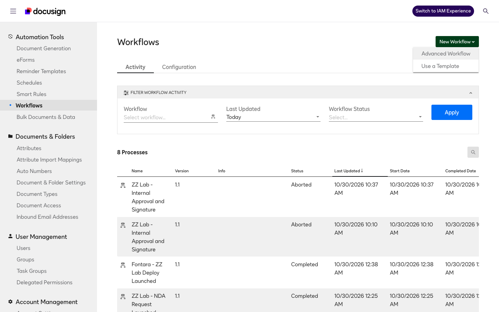

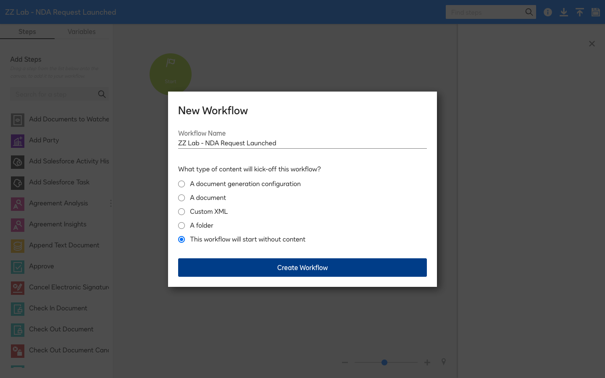

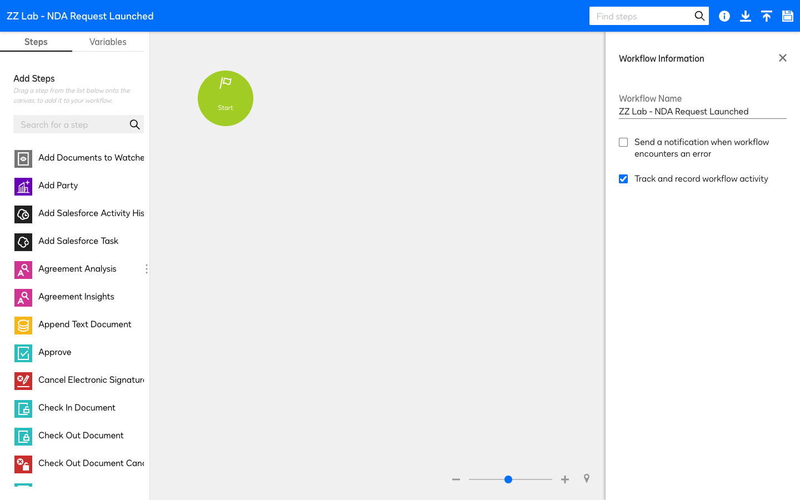

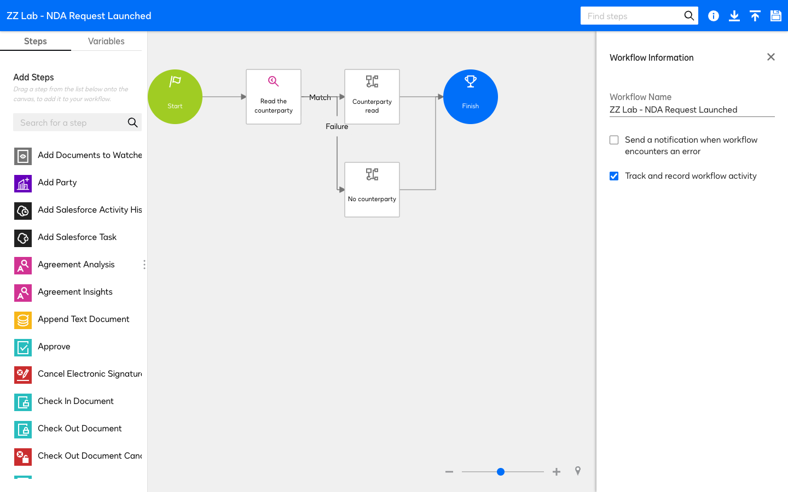

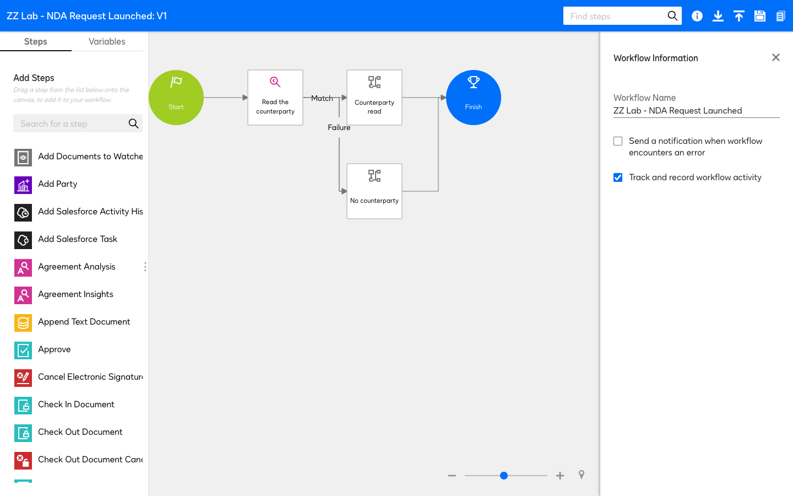

**What you pick:** nothing during the import. Import replaces the open canvas and takes the name from the file
(the Start step's workflow name). After it:
- **Re-pick every assignee.** Users and groups arrive as the GUIDs in the file. An unknown GUID still saves and
  publishes, and the designer shows no error, so check each assigned step by hand.
- **Pick each task group the README names.** A step assigned to a task group arrives with the group empty when the
  file was built without the account's task group ids: open the step ▸ Assignee(s) ▸ **Assigned Task Group** ▸ pick
  the group (the Task Group Assignee, if the file has one, is already set) ▸ Save the workflow.

**What to check after:** Save, then publish from the Versions panel. **Import does not publish.** A
configuration that launches the workflow needs it published.

**Common errors:**
- Save answers `success: false` and the page shows nothing: the name is taken, or it has a refused character
  (CLM names allow letters, digits, spaces and `- _ '` — no `·`).
- The canvas silently resets to just Start: the file is not a workflow (`definition: null`).

## CLM doc-gen form

**There is no upload:** CLM has no form import. The bundle carries the form's configuration (`.clm-form.json`),
a build sheet (`.md`) with each field and merge tag, and, when the form has one, its Word template (`.docx`).

- **By hand:** CLM ▸ Automation Tools ▸ **Document Generation** ▸ **Forms** ▸ **Create Form**. Add the fields of
  the build sheet in order, set each merge tag as listed (Edit Merge Tag where it differs from the label), Save.

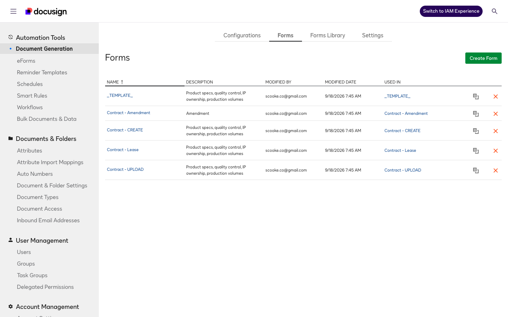

**What to check after:** open the form and fill it once; a field with a condition shows only when its condition
holds. The Word template's merge tags must equal the form's tags.

## CLM doc-gen configuration

**There is no upload.** The bundle carries a build sheet.

- **By hand:** upload the `.docx` into the destination folder first. Then CLM ▸ Automation Tools ▸ **Document
  Generation** ▸ **Configurations** ▸ **Add Configuration**: the name, a template row (the form and the `.docx`),
  the destination folder, and Launch a workflow ▸ the CLM workflow. Save.

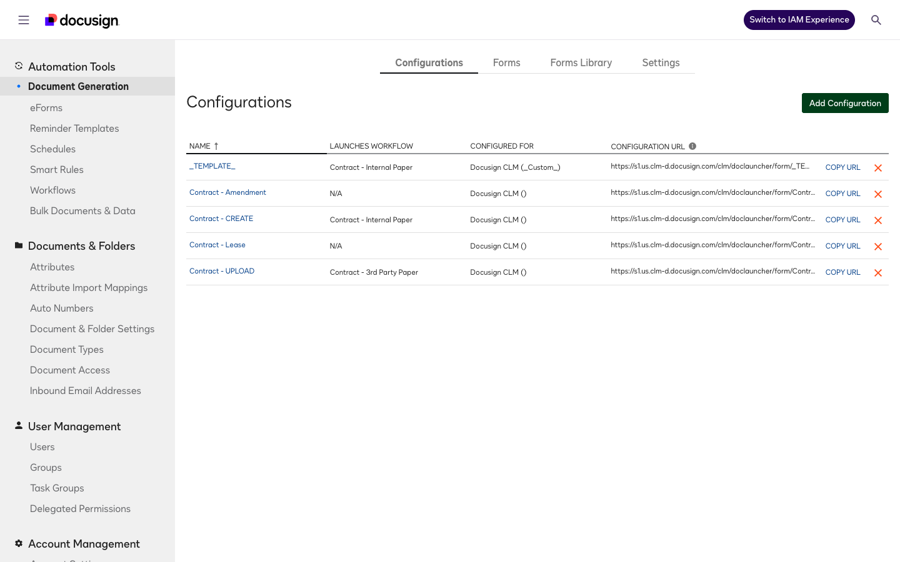

**What to check after:** the launched CLM workflow is **published** before you save the configuration; the
configuration opens its form, and a generate puts the document in the folder. A configuration with no workflow to launch opens as
"Invalid Document Generation configuration", even from a workflow's Create or Upload Doc task [observed 2026-10-31]:
always set Launch a workflow. When the workflow prefills the form (a `prefillXml` step), keep the form's merge tags
at the names the workflow uses.

## CLM eForm

**There is no upload:** CLM has no eForm import, and the deploy does not build eForms. The bundle carries the
form's HTML (`eforms/<id>.html`) and its steps (`eforms/<id>.md`). The facts behind each step are in
CLM-EFORMS-GUIDE.md.

**Click path:** CLM ▸ **Admin** ▸ Automation Tools ▸ **eForms** (the page is `/clm/Forms/BrowseForms.aspx`) ▸
**Form** ▸ **Create** ▸ the name ▸ paste the whole `.html` into the HTML box ▸ **Save**. Then, with the form
selected in the list:
1. **Routing** ▸ **Set Submit Folder**: the folder the steps name (it must exist).
2. **Routing** ▸ **Set Workflow**, when the steps name a CLM workflow: it must be published first. Each submit
   starts it with the `.sxform` as its Params document.
3. **Access** ▸ **Allow Submission**. When the steps say so: **Allow Updates** (a submitted form reopens as Update
   Form), **Enable Repository Attachments**, **Attachment Required**.

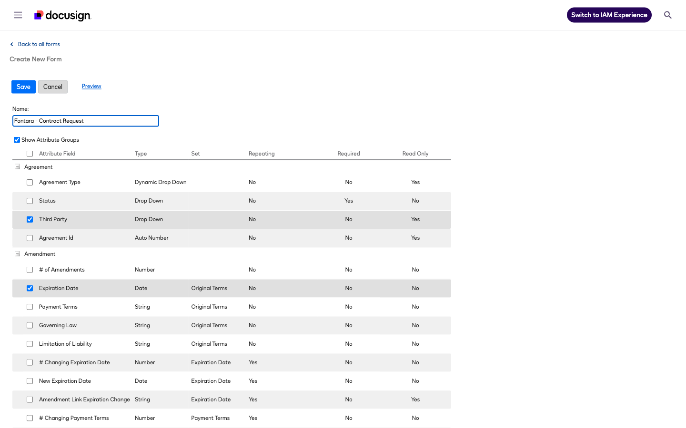

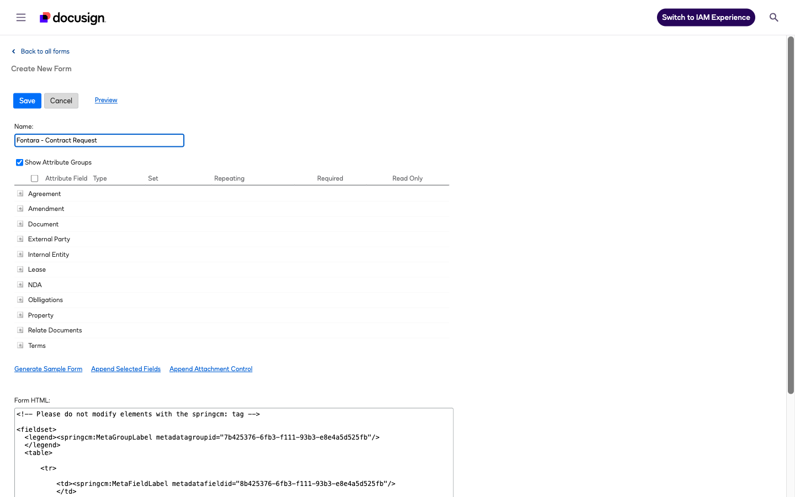

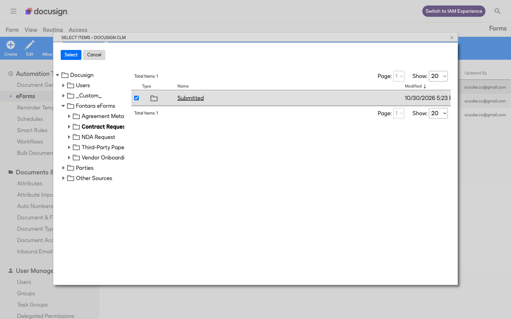

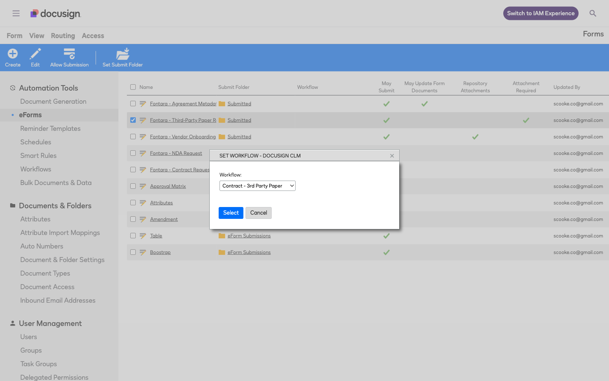

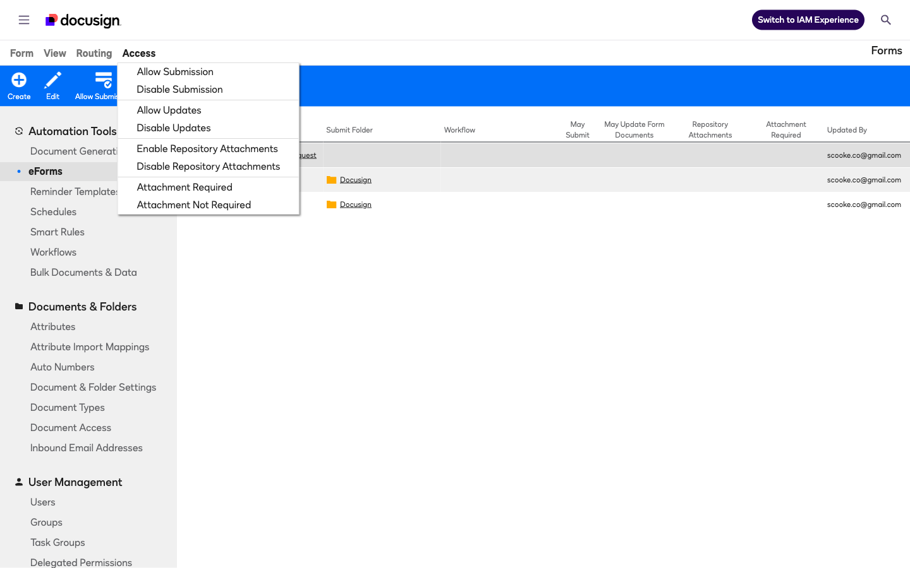

**What you pick:** the attribute field ids, when the HTML holds `REPLACE:<Group.Field>` placeholders: tick each
group the steps list in the picker, press **Generate Sample Form**, copy each field's `metadatafieldid` from the
generated `<springcm:MetaFieldInput …/>` tags into the `.html`, then clear the generated HTML and paste the
whole `.html`. The ids are the account's own: a bundle built for one account does not fit another.

**What to check after:**
- **Every Save of the form turns off Allow Submission and Allow Updates.** Turn them on again after each edit.
  An edit also applies to forms already submitted: they open with the new HTML.
- **Preview** shows every part of the form: its show-if rules and checks run only on the submit page (CLM raises
  its load event there, not in Preview).
- Submit it once: the folder gets `<form name>.sxform` with the attributes, and each attachment as its own
  document. The form answers (custom ids) are in the `.sxform` content, not in the attribute panel.
- Save As copies the HTML only, not the folder, workflow or access settings.

**Common errors:**
- A field shows "Unable to load file|/_Custom_/System Files/…": a dynamic drop-down attribute whose CSV is missing.
- A field is missing from the form: its attribute id is not in this account (a placeholder left, or another
  account's id).
- A form answer is empty in the workflow: read `CustomFormFields/<id>` in Params (letters and digits only), not
  an attribute.
