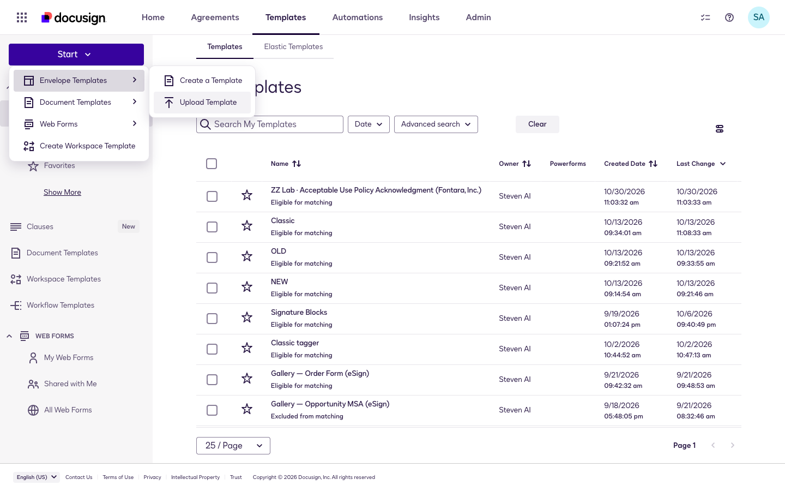
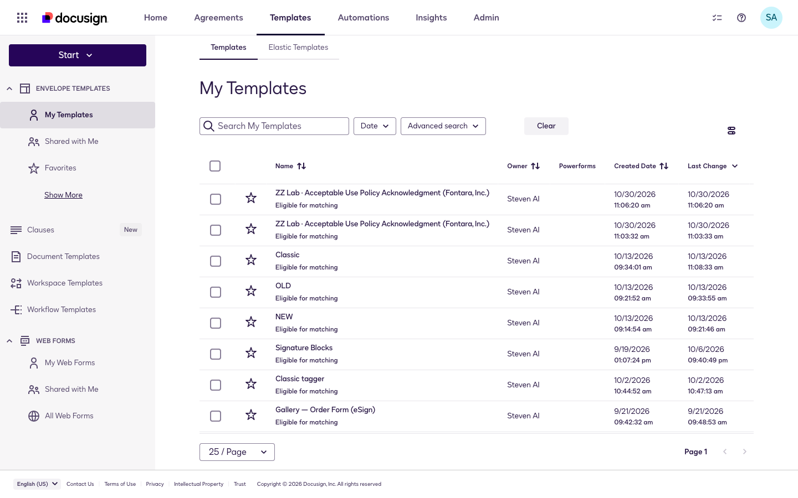
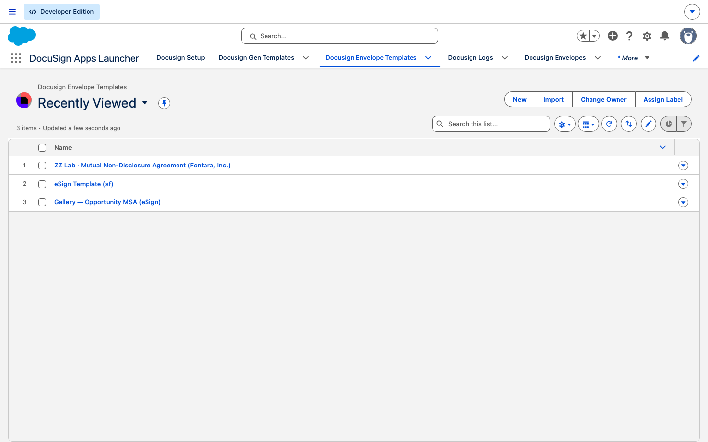
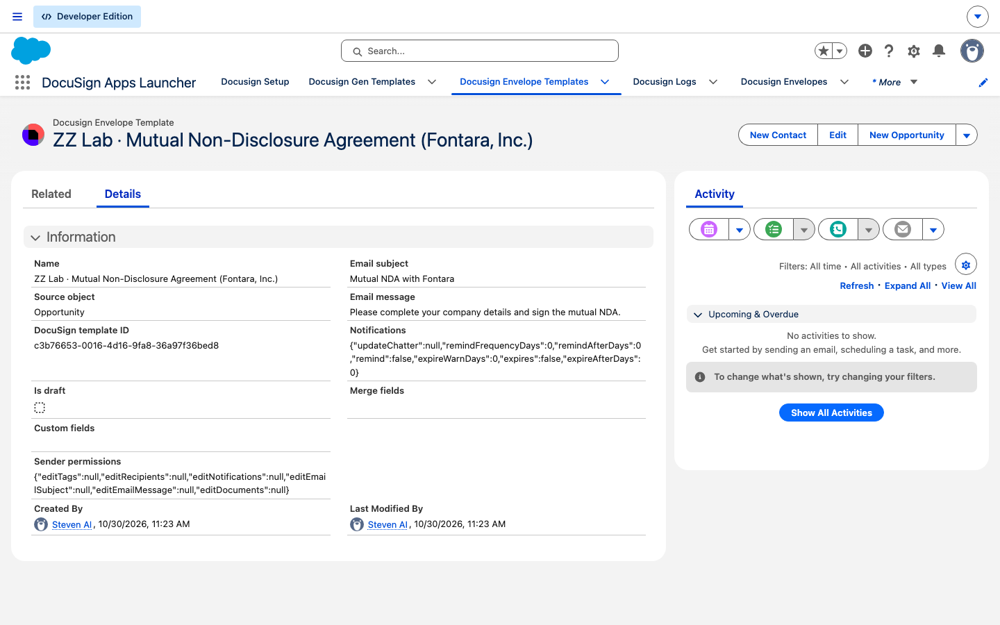

<!-- GENERATED by scripts/build-docusign-skills.ts from docs/UPLOAD-GUIDES.md in the gallery repo. Do not edit. -->

# Uploading an eSignature template

Where to click, what the upload asks you to pick, what to check afterwards and which errors to expect. The screens were taken on the gallery repo's lab account (2026-10-30).

## eSignature template

**Click path:** Templates ▸ **Start** ▸ **Envelope Templates** ▸ **Upload Template** ▸ choose the `.json`. JSON,
XML or ZIP up to 25 MB. An upload **always makes a new template**; it never updates one.

**What you pick:** nothing.

**What to check after:** open the template: the documents, the roles and every tab are there; reminders, expiry
and copies as the README says. If the account has a **required** envelope custom field, a send from this
template (or a workflow's send step) cannot be set up until it is filled.

**Common errors:**
- `NOTARY_INVALID_NOTARY_TABS_ONLY_ALLOWED_FOR_NOTARY`: a phone tab on a signer, in-person signer or witness.
- `ANCHOR_TAB_STRING_NOT_FOUND` (at send): a tab's anchor is not in the document.
- The same file uploaded twice: two templates of the same name.

## Salesforce envelope templates

**There is no file upload.** An eSignature for Salesforce envelope template is Salesforce records
(`dfsle__EnvelopeConfiguration__c` and one `dfsle__EnvelopeConfigurationRecipient__c` per signer role) that point
at an eSignature template by its id (`dfsle__DocuSignId__c`); the documents and tabs come from that template.

**What you pick:** nothing. The order matters: the eSignature template exists first, because the records name its
id. The bundle README marks an eSignature template with a Salesforce block and links here.

**What to check after:** the template is listed under Docusign Envelope Templates, its record shows the eSignature
template's id and **Is draft** unticked (inserted without `dfsle__IsDraft__c: false`, a configuration is a draft;
the compiler writes `false`). Every Salesforce field and related list it names must exist in the org. The list's own **Import**
button was not tried.

**To send from a record you need a button.** The sending page opens only from a custom button on the source
object's page layout (opened directly it refuses: "This page requires a CSRF confirmation token"). A spec with
`salesforce.button` gets one from the deploy (a Metadata API deploy of a WebLink); by hand, open the template in
Salesforce ▸ the wizard's last step (Custom Button). Either way, add the button to the page layout yourself
(Setup ▸ Object Manager ▸ <object> ▸ Page Layouts ▸ Buttons). Proven 2026-10-31: from
a ZZ Lab Opportunity, the page loaded the template's document, found the counterparty through the contact-role lookup,
made the sender the Fontara signer, and made a draft envelope (not sent).
