# Upload guides: putting a bundle's files into an account

A bundle (`scripts/build-solution.ts`, [SOLUTION-SPEC.md](SOLUTION-SPEC.md)) holds one file or build sheet per
asset, and its `README.md` gives the upload order. This page says, per asset kind, where to click, what the
upload asks you to pick, what to check afterwards and which errors to expect. Each `Upload:` line of a bundle
README links to its section here.

The screens were taken on 2026-10-30 on the lab account with the files of one ZZ Lab bundle (one asset of
each kind from the library), uploaded through the product's own screens by
[`captures/capture-upload-guides.ts`](../captures/capture-upload-guides.ts). Everything the uploads created was
ledgered and then deleted by id (`captures/park-scenario.ts --scenario=upload-guides`). The Salesforce screens
follow a `deploy-scenario --solution` of one eSignature template with a Salesforce block (scenario `upload-guides-sf`, parked too). The error lists come from the
[error index](ASSET-FORMATS.md#error-index) of ASSET-FORMATS.md.

| Asset kind | File in the bundle | How it gets in |
|---|---|---|
| [Workflow Builder package](#workflow-builder-package) | `NN-workflow-<name>.zip` | Import Workflow |
| [Request statuses](#request-statuses) | inside a workflow package | the workflow's import |
| [Request type package](#request-type-package) | `NN-request-type-<id>.zip` | Request types ▸ Import |
| [Web form](#web-form) | `NN-webform-<id>.json` | Upload Configuration |
| [Template-linked web form](#template-linked-web-form) | `.esign-template.json` + build sheet `.md` | no upload: build it, or the deploy |
| [Document template](#document-template) | `NN-document-template-<id>.zip` | + Create New ▸ Upload |
| [eSignature template](#esignature-template) | `NN-esign-template-<id>.json` | Upload Template |
| [CLM workflow](#clm-workflow) | `NN-clm-workflow-<id>.json` | the designer's Import |
| [CLM doc-gen form](#clm-doc-gen-form) | `.clm-form.json` + build sheet `.md` + `.docx` | no upload: build it, or the deploy |
| [CLM doc-gen configuration](#clm-doc-gen-configuration) | build sheet `.md` | no upload: build it, or the deploy |
| [CLM eForm](#clm-eform) | `eforms/<id>.html` + steps `eforms/<id>.md` | no upload: paste the HTML |
| [AI agent](#ai-agent) | build sheet `.md` + `.revision.json` | no upload: build it, or the deploy |
| [Salesforce envelope templates](#salesforce-envelope-templates) | none: compiled from the eSignature template spec | Salesforce records, inserted by the deploy |
| [Lookup table](#lookup-table) | `lookup-table-<table>.csv` beside the workflow package | the step's Upload after import, or the deploy |
| [Bulk send](#bulk-send) | `NN-…-<id>.bulk-send.csv` beside an eSignature or document template | Bulk send ▸ Upload a file when sending |
| [Agreement Manager: Track obligations](#agreement-manager-track-obligations) | none: an account setting (a prerequisite) | Agreements ▸ Completed ▸ Track obligations |

Most of the kinds without an upload can also be put in by `captures/deploy-scenario.ts --solution=<manifest>`
([SOLUTION-SPEC.md](SOLUTION-SPEC.md)), which uses the product's own API calls.

## Workflow Builder package

**Click path:** Agreements ▸ Workflows ▸ **Create Workflow** ▸ **Import Workflow** card ▸ choose the `.zip`.
The card opens the file picker at once; there is no separate upload dialog. On an account with no workflows yet,
the Workflows page shows **Create Workflow** and **Import Workflow** buttons instead: use **Import Workflow**.

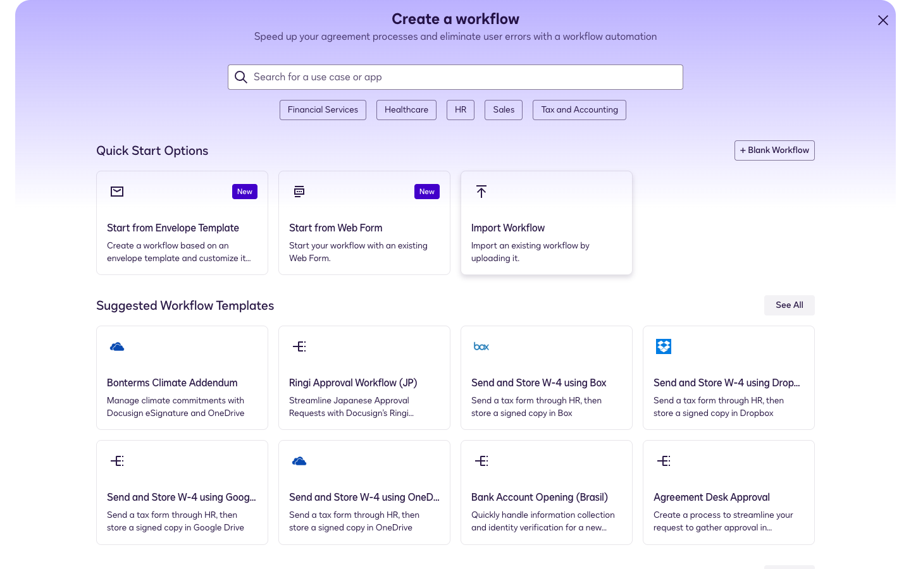

**What you pick during the import:**
- **A connection for each connected app** the package uses (an `ACT` component, for example Salesforce). The
  dialog "Select connections for connected apps" lists the account's connections of that app; pick one, then
  **Next**. The app must already be installed and connected (App Center): the import does not install it.
- Nothing else is asked. Request types, web forms, document templates, eSignature templates and statuses the
  package carries are created as new copies, and the steps are re-pointed to them.

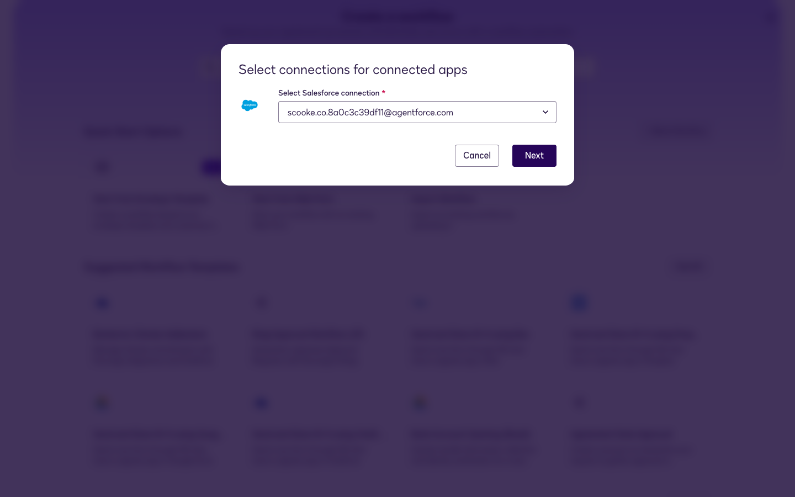

The import then runs "Checking for errors…" (it can take a minute) and the workflow lands as a **draft**.

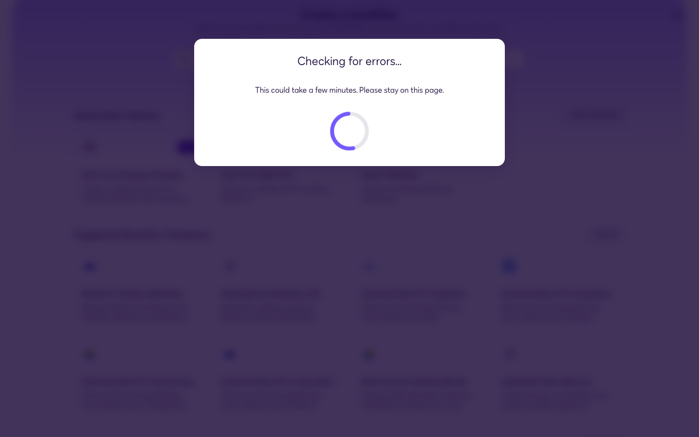

**What to check after:**
- Open the draft. A step with a red marker is not fully configured. A generated document's send step can show
  Participant "Select" until it is picked again: the bundle README names each send step, its roles and the
  participant to pick for each.
- **Apply** closes a step's drawer but does not save the draft: press **Save Draft** (top right) after each step, or
  a reload loses the change.
- An approver, follower or owner is picked from the account: in the step, remove the placeholder, then **Pick a user
  or group** and choose the person (a user of the account with Agreement Desk). It cannot be typed as an address.
- A request type is **active** as soon as the import creates it, before the workflow is published: a request
  submitted before the publish starts nothing.
- **Set a signing order** always shows OFF after an import: the toggle is not stored. The orders shown next to each
  role are applied anyway (the second signer gets the envelope after the first), so leave the toggle as it is.
- A send step whose envelope waits as a draft for the person who starts the workflow cannot be shown that way in its
  drawer: saving that step switches its sender to **Automatically**. The bundle README says which steps this is.
  Re-picking a participant needs **Apply** (closing the drawer asks to discard the pick), and Apply is that save.
- An **Execute AI Agent** step names its agent by key. If you made the agent by hand, pick it again in the step.
- **Prepare eSignature Template**: open its drawer and check the fills show on Mapping fields. If they show empty,
  do not press Save there: Save clears every fill and unlocks the tabs. Close the drawer, or map each fill again
  before saving. `workflow:check` and the solution check name any step whose fills the drawer will show empty.
- The web forms the package created must be **Active** before you publish.
- **Review & Publish** runs the check again ("This workflow is ready to publish") and then asks for the instance
  name. Publishing can ask for consent to the steps' access (*Authorize application senders*, once per publisher)
  and, with an agent step, for the AI disclaimer: Docusign's own words ("This workflow runs without a person in the
  loop. It will execute using the permissions of <user>…") under a required **Confirm** box, on every publish.
  The publisher ticks it; nobody may tick it for them. A tool that publishes for a person must show Docusign's
  words as the check returned them and wait for that person's explicit agreement (the workflow spec reference, *Publishing*).
- A workflow started from Salesforce has a new id and URL: add it to the Start with Docusign launcher, or point
  the Flow's action at it.

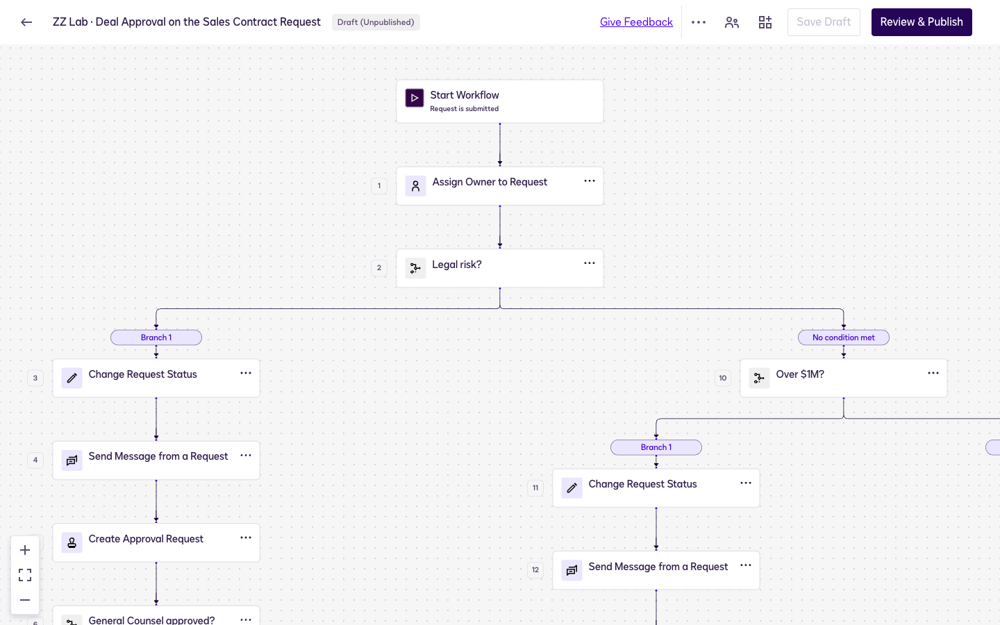

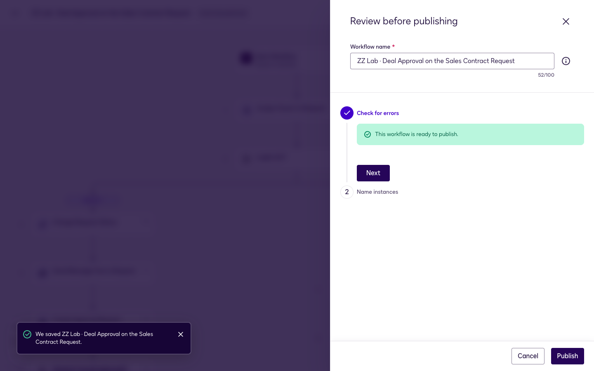

**What the import also does, for good:** it creates or updates the account custom fields the package carries
(`C_…`). Only an account admin can delete one, by hand (Agreement Manager ▸ Manage ▸ Fields), and values already on agreements stay. The README lists them.

**Common errors:**

| Error | Cause |
|---|---|
| `500 ERR_10999` "Failed to create workflow definition" | no trigger; an unknown participant; a missing component file; a misspelled `componentType`; a send with two documents |
| `500 ERR_10999` "Failed to import request status …: 400" | more than 30 live statuses after the import; a status name over 40 characters |
| `403 ERR_10026` | a carried status has the name of a deleted status |
| `404 ERR_13009` "Failed to create document template" | a Salesforce field the template reads is not in the connected org |
| `400 ERR_13004` "Failed to create eSign template" | a Prepare eSignature Template step names a template the package does not carry |
| `ERR_10202` "Failed to validate Import zip package" | a component listed twice |
| `500 ERR_10999` "Virus scan failed due to retries exhausted" | the import service's scan, not the file: nothing is created; import again later (2026-10-30 it failed for over an hour on both demo accounts, for an unchanged export too) |
| `ERR_19004` | Read from Salesforce outputs missing from the variables |
| `500 … reading 'savedValues'` | `config-instances.json` missing |
| nothing imported | the connection dialog was cancelled or left: import again and pick a connection |
| "You need access to the Agreement Desk components used in this workflow. Contact your administrator…", nothing imported | Agreement Desk is not set up yet: Requests shows "Start collaborating on agreements" with **Get Started**. An admin clicks Get Started (it adds 6 default statuses and 4 [Example] request types), then import again |

At run time: a request-started run that fails at its first request step (Change Request Status) with `403 ERR_10999`
"Error updating ticket for Agreement Desk scope" acts as a publisher who cannot manage all requests: the account admin
gives that user "Can manage" access to all of the account's agreements (the bundle README's prerequisite).

At publish: "Add at least one step to the 'No Conditions Met' workflow branch" means a branch without a default
path; the compiler now refuses that.

## Request statuses

**No upload of their own.** A workflow package carries the statuses its steps and its start use, and the
workflow's import creates them. A carried status with the account's live id and name is reused; a new name is
created. A carried status whose **name** matches a live status is reused too, even with another id (seen
2026-11-01: the import took the account's own "Approved"). Such a status is shared with live work: leave it when
you clean up a test copy, and build a test copy with a name prefix so its statuses get their own names. Check them
in Requests ▸ Settings ▸ **Statuses**.

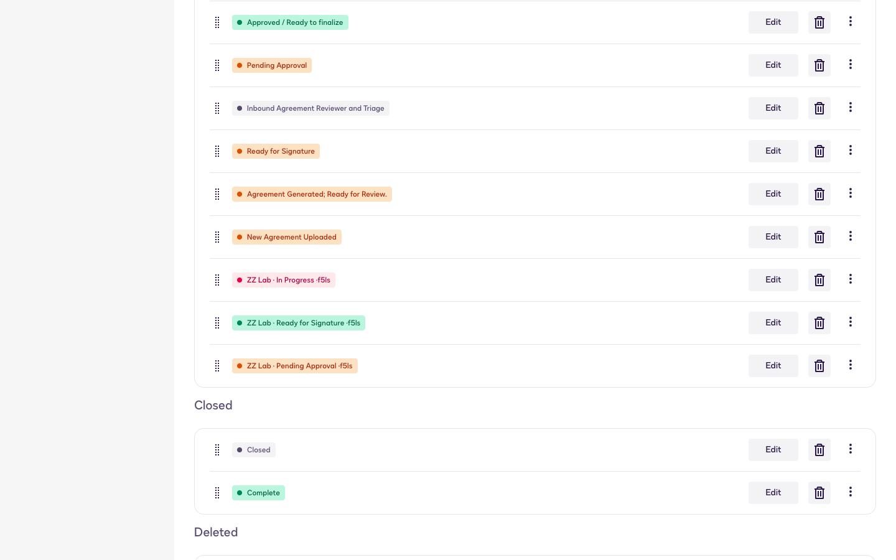

**Limits and errors:**
- At most **30 live statuses** in an account (deleted ones do not count). The import that would pass 30 fails
  with `500 ERR_10999`, and statuses before it may already exist. The README's prerequisite line gives the
  number this bundle adds.
- A deleted status keeps its name for good: importing that name again fails `403 ERR_10026`, and renaming
  another status to it fails `400 VALUE_DUPLICATE`. To reuse a name, keep the status live.
- A name over 40 characters fails the import.

(Statuses can also be exported and imported on their own in Settings ▸ Statuses; the bundles do not use that.)

## Request type package

**Click path:** Agreements ▸ Requests ▸ Settings ▸ **Request types** ▸ **Import** ▸ **Select file** (the `.zip`)
▸ **Import**. A toast says "Import Completed"; the type arrives **active**, with its intake form.

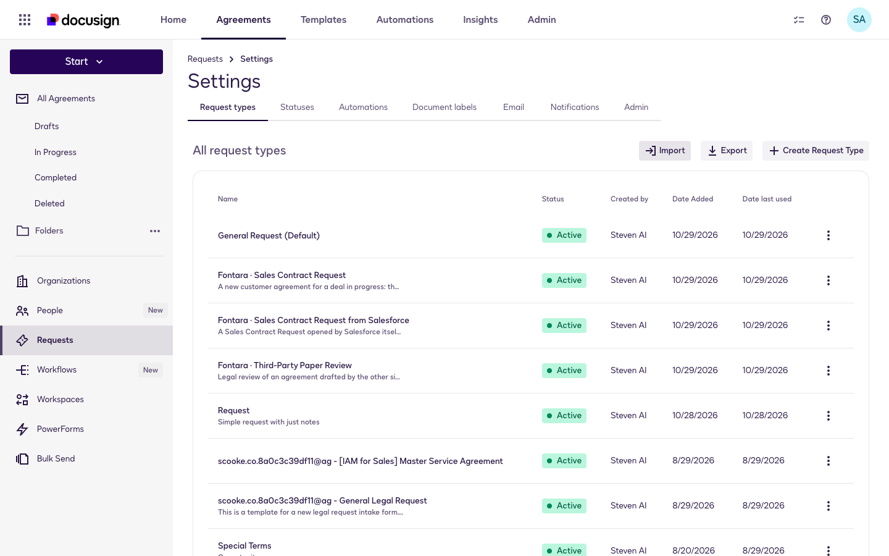

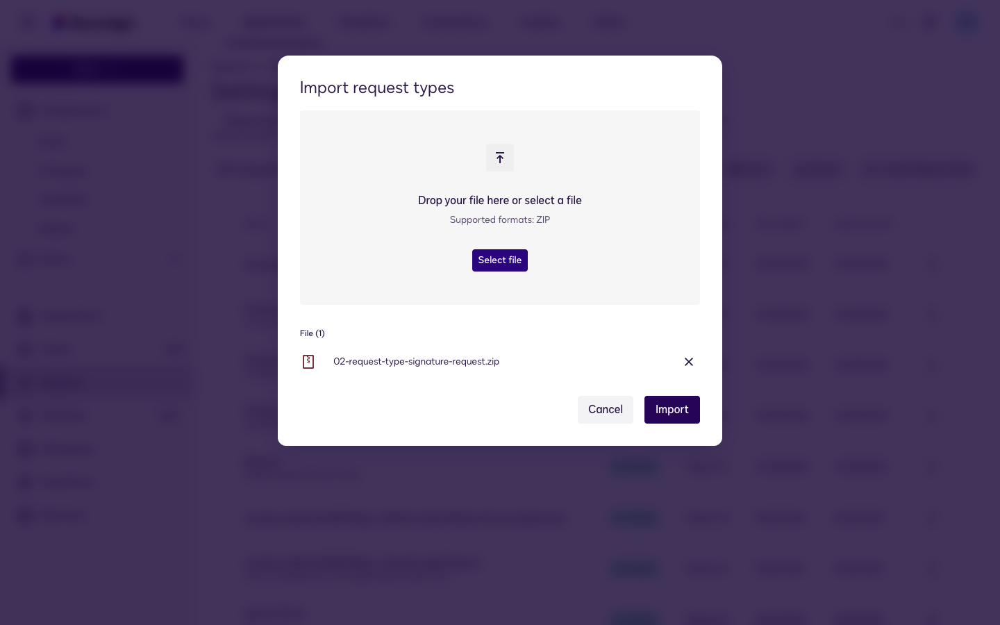

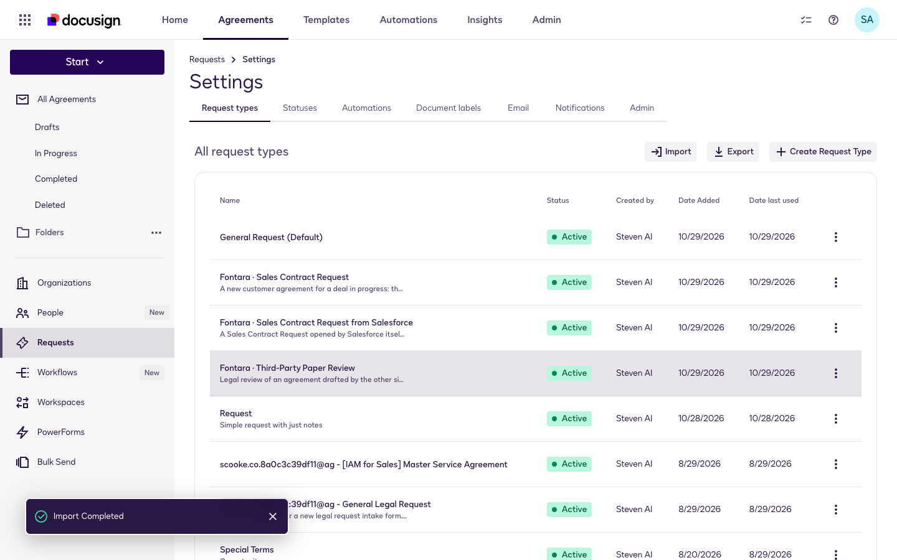

**What you pick:** nothing.

**What to check after:** the type is in the list and Active; open it and preview the intake form. A workflow that
starts on this type matches it by **name**, so do not rename it.

**For good:** the import creates or updates the account custom fields of the intake form (listed in the README).
An existing field of the same name is updated, not duplicated, and only an account admin can delete a field, by hand.

**Common errors:**
- Importing the same package twice makes a second type "… (1)": import never overwrites.
- "Failed" with nothing created: more than about 50 components, or an intermittent failure (import it again).
- `400 Cannot instantiate the abstract type "ContractValue"` on SUBMIT: an intake field bound to `ContractValue`.

## Web form

**Click path:** Templates ▸ **Start** ▸ **Web Forms** ▸ **Upload Configuration** (the help calls it Upload Web
Form) ▸ choose the `.json`. The form opens in the builder as a **Draft**.

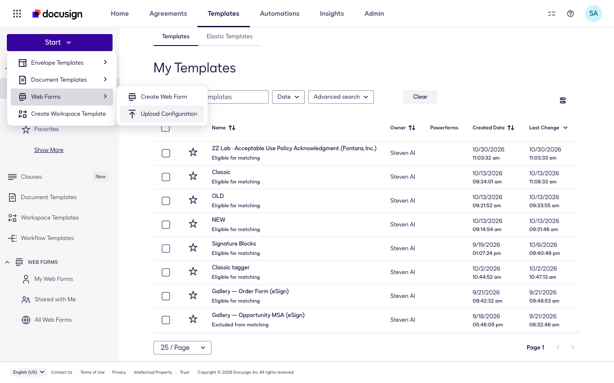

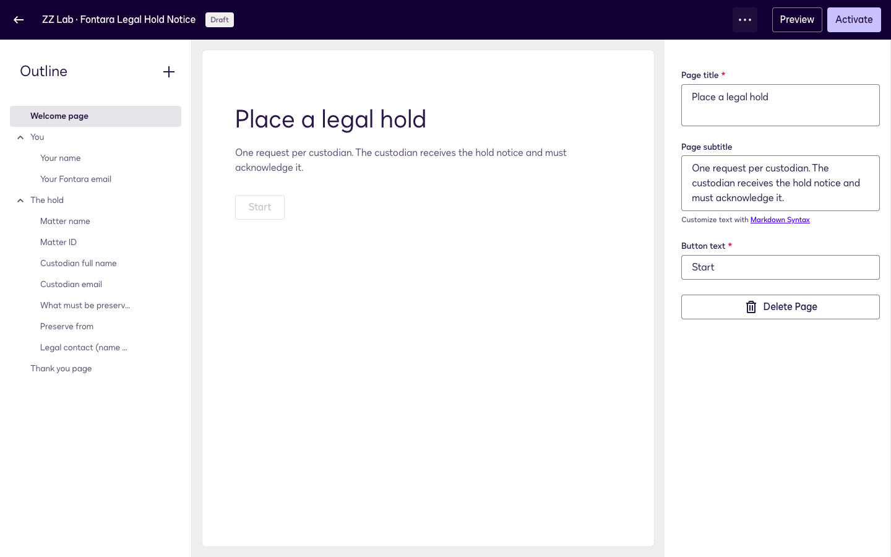

**What you pick:** nothing.

**What to check after:** go through the pages with **Preview**, then **Activate**. A workflow can only publish
with its forms active. Uploading the same file twice made two forms of the same name (2026-10-30).

**Common errors:**

| Error | When | Cause |
|---|---|---|
| `400` | upload | `eSignTemplates` or `formContent.templates` missing; a template-linked configuration (see below) |
| 200, but the form is blank | upload | `isStandalone` missing |
| `400 DuplicateName` | activate | a component's map key differs from its `componentKey` |
| `400 ConflictWithPublishedName` | activate | a field name like another type's automatic name |
| `400 InvalidText` | activate | an option value with a space, a `mailto:` Thank-you URL, an ISO date default |
| `500` | activate | `schemaVersion: 2` |

## Template-linked web form

**There is no upload.** Upload Configuration refuses a form linked to an eSignature template, because its links
name the tab ids of a template copy that exists only after the form is made. The bundle carries the template
(`.esign-template.json`), the form spec and a build sheet (`.md`). Two ways in:

1. **By hand:** upload the `.esign-template.json` ([eSignature template](#esignature-template)). Then Templates ▸
   **Start** ▸ **Web Forms** ▸ **Create Web Form** ▸ **Transform a template** and pick that template. The builder
   makes a copy ("Web Form Copy - …") and writes a field per text tab of the filling role and a Signature page.
   Set the labels, pages, Welcome and Thank-you texts and the signing settings from the build sheet, then
   **Activate**.
<!-- repo -->
2. **By the deploy:** `captures/deploy-scenario.ts --solution=<manifest>` does all three steps with the builder's
   own calls (create from the template, save, activate).
<!-- /repo -->

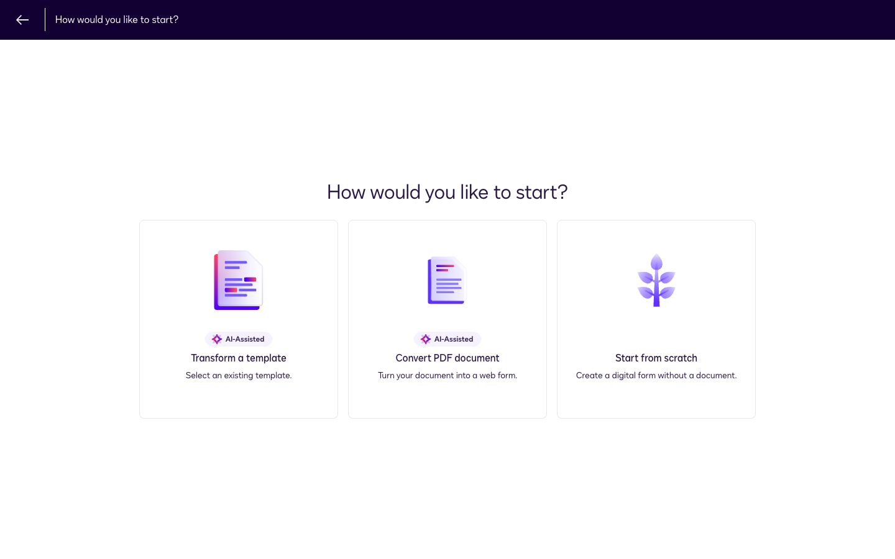

**What to check after:** the Signature page lists each signer role with a name and an email field; the form is
Active. Deleting the form later moves the template copy to Deleted Items.

## Document template

**Click path:** Templates ▸ **Document Templates** ▸ **+ Create New** ▸ the "Upload file" dialog ▸ **Upload**
(the `.zip`) ▸ **Continue**. With a `.zip` the dialog drops the Name field: the name comes from the file. The
template lands as a **Draft**.

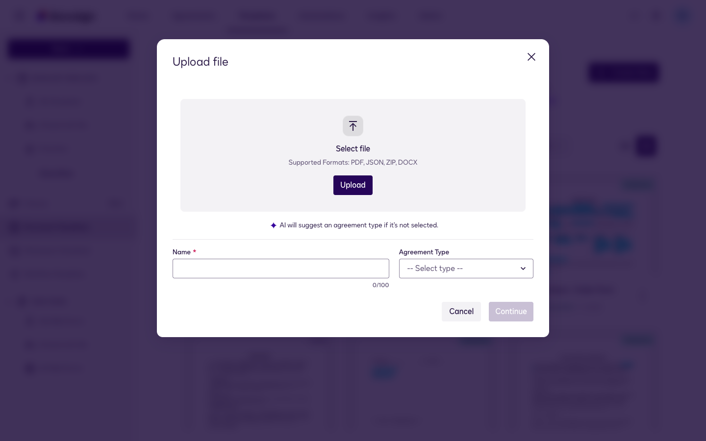

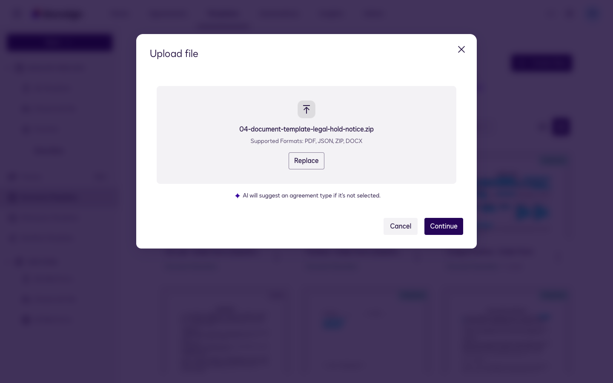

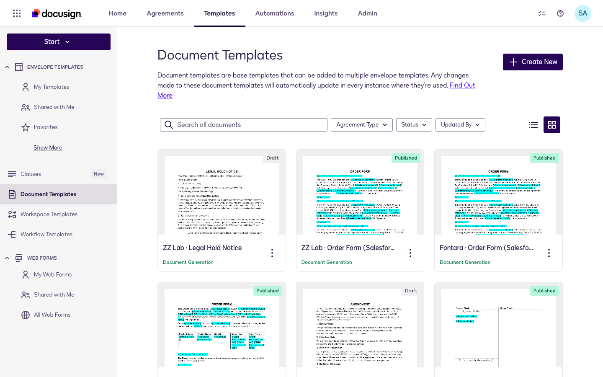

**What you pick:** nothing.

**What to check after:** open it, check the fields and the preview, then **Publish**. A Salesforce-bound template
needs every field it reads in the connected org. (A document template carried inside a workflow package arrives
already published, as in the screen above.)

**Common errors:**
- `400 ItemAlreadyExists`: the name exists in the account.
- `400 FieldNotFound` "…fields that are not supported in your current account": a financial provision path.
- `400` "The DocumentBase64 field is required.": the document is missing from the file.
- `404 ERR_13009` (through a workflow import): a Salesforce field missing from the connection.

## eSignature template

**Click path:** Templates ▸ **Start** ▸ **Envelope Templates** ▸ **Upload Template** ▸ choose the `.json`. JSON,
XML or ZIP up to 25 MB. An upload **always makes a new template**; it never updates one.

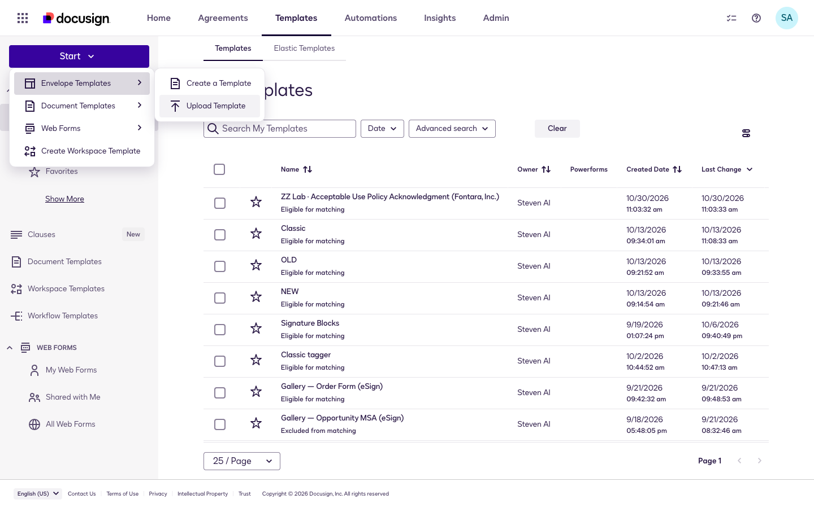

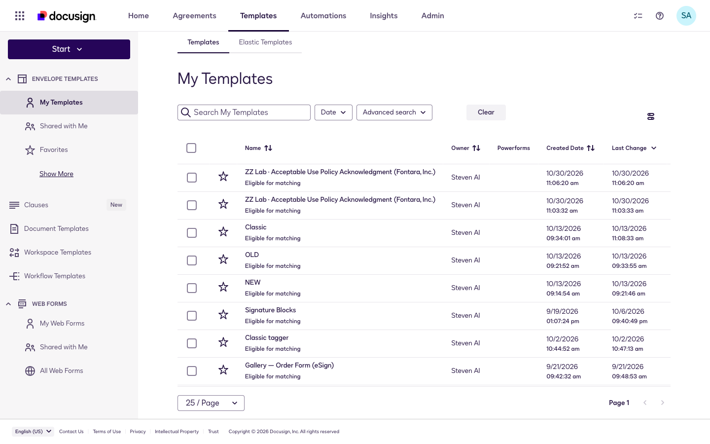

**What you pick:** nothing.

**What to check after:** open the template: the documents, the roles and every tab are there; reminders, expiry
and copies as the README says. If the account has a **required** envelope custom field, a send from this
template (or a workflow's send step) cannot be set up until it is filled.

**Common errors:**
- `NOTARY_INVALID_NOTARY_TABS_ONLY_ALLOWED_FOR_NOTARY`: a phone tab on a signer, in-person signer or witness.
- `ANCHOR_TAB_STRING_NOT_FOUND` (at send): a tab's anchor is not in the document.
- The same file uploaded twice: two templates of the same name.

## CLM workflow

**Click path:** CLM ▸ Automation Tools ▸ **Workflows** ▸ **New Workflow** ▸ **Advanced Workflow** (opens the
designer in a new tab) ▸ give a name and choose **"This workflow will start without content"** ▸ **Create
Workflow** ▸ toolbar **Import** (the up-arrow icon) ▸ choose the `.json` ▸ **Save** (the disk icon).

Use the designer's Import. **Not** Admin ▸ Workflows ▸ Download Workflow (a download only, no upload) and **not**
Admin ▸ Deployment (a signed `.spackage`, which nothing here makes).

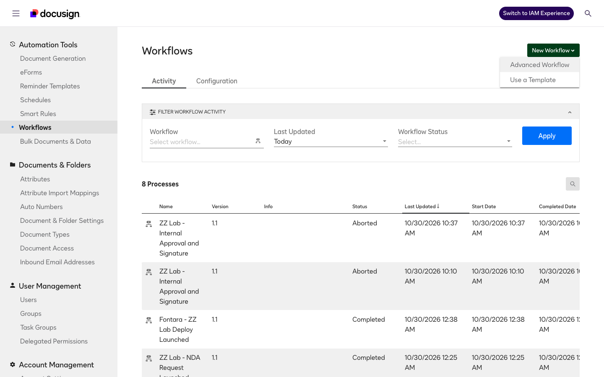

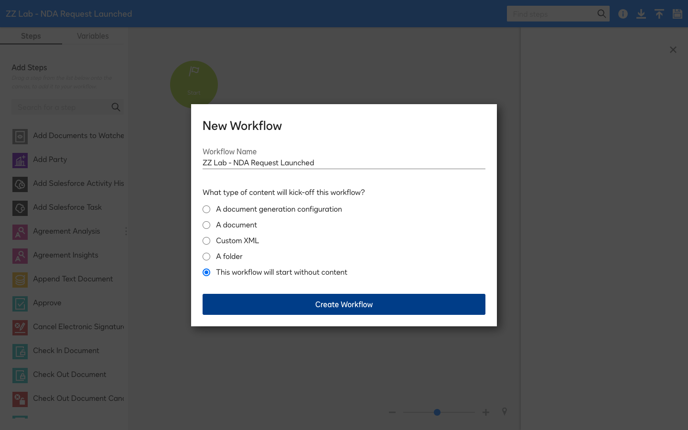

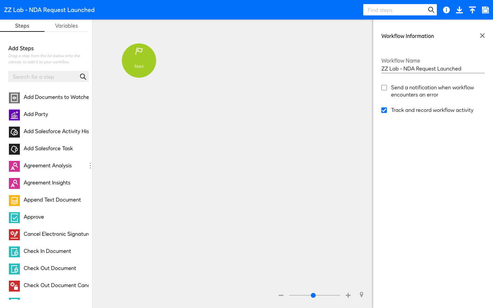

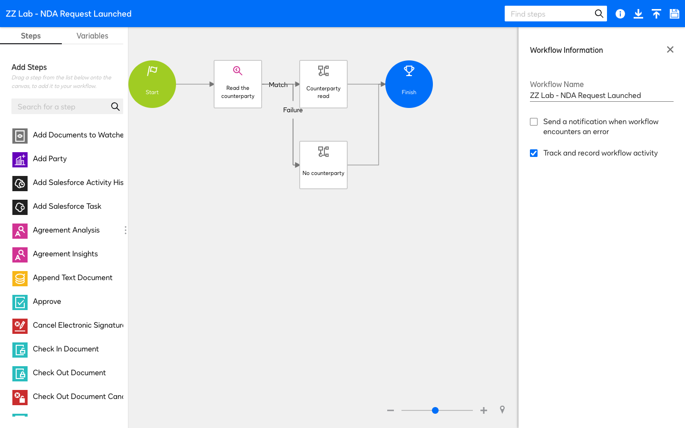

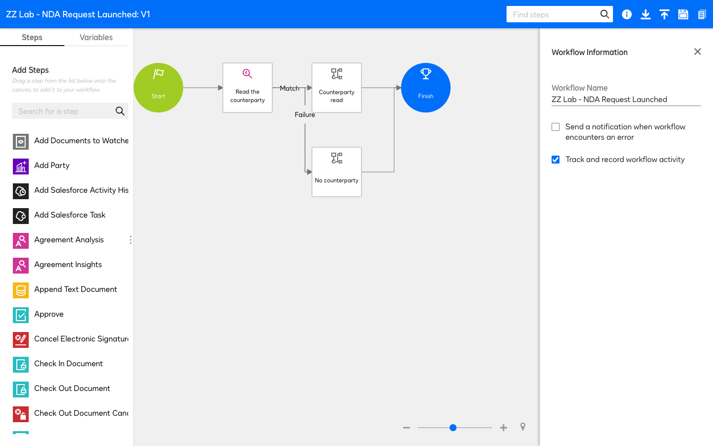

**What you pick:** nothing during the import. Import replaces the open canvas and takes the name from the file
(the Start step's workflow name). After it:
- **Re-pick every assignee.** Users and groups arrive as the GUIDs in the file. An unknown GUID still saves and
  publishes, and the designer shows no error, so check each assigned step by hand.
- **Pick each task group the README names.** A step assigned to a task group arrives with the group empty when the
  file was built without the account's task group ids: open the step ▸ Assignee(s) ▸ **Assigned Task Group** ▸ pick
  the group (the Task Group Assignee, if the file has one, is already set) ▸ Save the workflow.

**What to check after:** Save, then publish from the Versions panel. **Import does not publish.** A
configuration that launches the workflow needs it published.

**Common errors:**
- Save answers `success: false` and the page shows nothing: the name is taken, or it has a refused character
  (CLM names allow letters, digits, spaces and `- _ '` — no `·`).
- The canvas silently resets to just Start: the file is not a workflow (`definition: null`).

## CLM doc-gen form

**There is no upload:** CLM has no form import. The bundle carries the form's configuration (`.clm-form.json`),
a build sheet (`.md`) with each field and merge tag, and, when the form has one, its Word template (`.docx`).

- **By hand:** CLM ▸ Automation Tools ▸ **Document Generation** ▸ **Forms** ▸ **Create Form**. Add the fields of
  the build sheet in order, set each merge tag as listed (Edit Merge Tag where it differs from the label), Save.
<!-- repo -->
- **By the deploy:** `captures/deploy-scenario.ts --solution=<manifest>` saves the configuration as the form
  editor does.
<!-- /repo -->

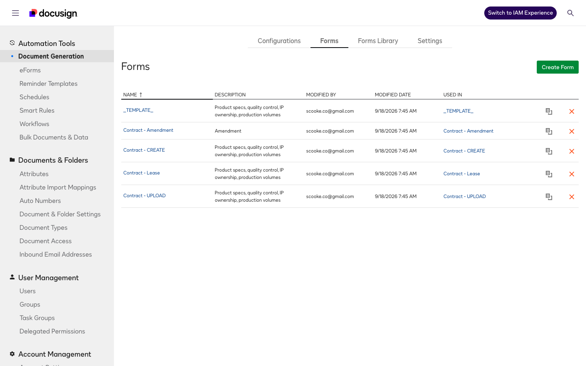

**What to check after:** open the form and fill it once; a field with a condition shows only when its condition
holds. The Word template's merge tags must equal the form's tags.

## CLM doc-gen configuration

**There is no upload.** The bundle carries a build sheet.

- **By hand:** upload the `.docx` into the destination folder first. Then CLM ▸ Automation Tools ▸ **Document
  Generation** ▸ **Configurations** ▸ **Add Configuration**: the name, a template row (the form and the `.docx`),
  the destination folder, and Launch a workflow ▸ the CLM workflow. Save.
<!-- repo -->
- **By the deploy:** `captures/deploy-scenario.ts --solution=<manifest>` uploads the template and saves the
  configuration (it needs the folder's uid in the manifest, `folder.uid`).
<!-- /repo -->

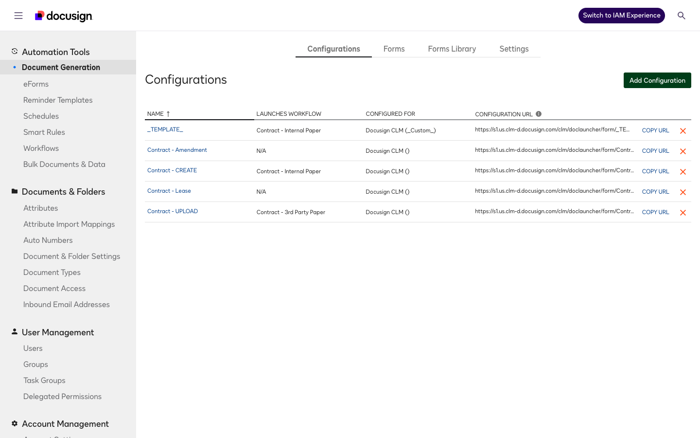

**What to check after:** the launched CLM workflow is **published** before you save the configuration; the
configuration opens its form, and a generate puts the document in the folder. A configuration with no workflow to launch opens as
"Invalid Document Generation configuration", even from a workflow's Create or Upload Doc task [observed 2026-10-31]:
always set Launch a workflow. When the workflow prefills the form (a `prefillXml` step), keep the form's merge tags
at the names the workflow uses.

## CLM eForm

**There is no upload:** CLM has no eForm import, and the deploy does not build eForms. The bundle carries the
form's HTML (`eforms/<id>.html`) and its steps (`eforms/<id>.md`). The facts behind each step are in
[CLM-EFORMS-GUIDE.md](CLM-EFORMS-GUIDE.md).

**Click path:** CLM ▸ **Admin** ▸ Automation Tools ▸ **eForms** (the page is `/clm/Forms/BrowseForms.aspx`) ▸
**Form** ▸ **Create** ▸ the name ▸ paste the whole `.html` into the HTML box ▸ **Save**. Then, with the form
selected in the list:
1. **Routing** ▸ **Set Submit Folder**: the folder the steps name (it must exist).
2. **Routing** ▸ **Set Workflow**, when the steps name a CLM workflow: it must be published first. Each submit
   starts it with the `.sxform` as its Params document.
3. **Access** ▸ **Allow Submission**. When the steps say so: **Allow Updates** (a submitted form reopens as Update
   Form), **Enable Repository Attachments**, **Attachment Required**.

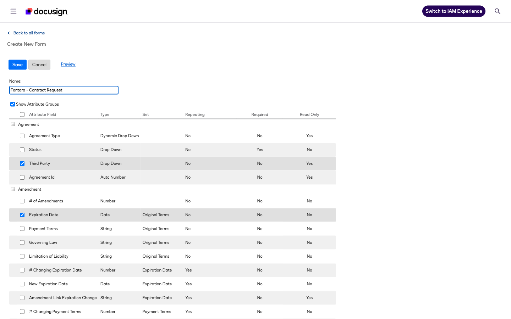

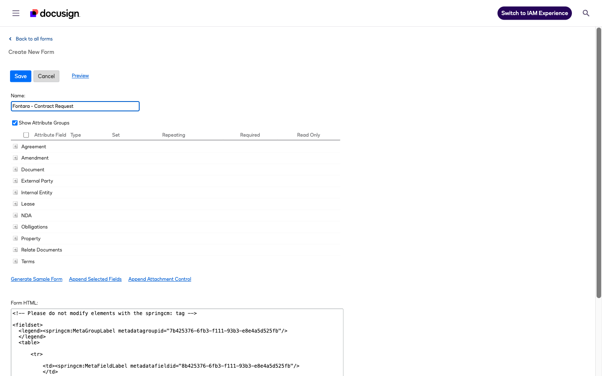

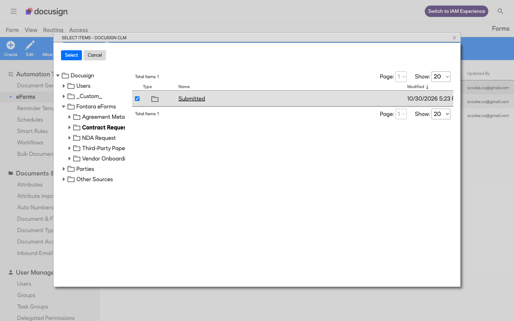

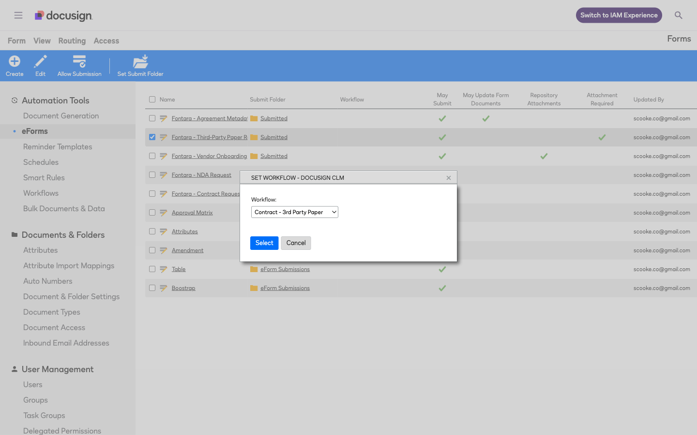

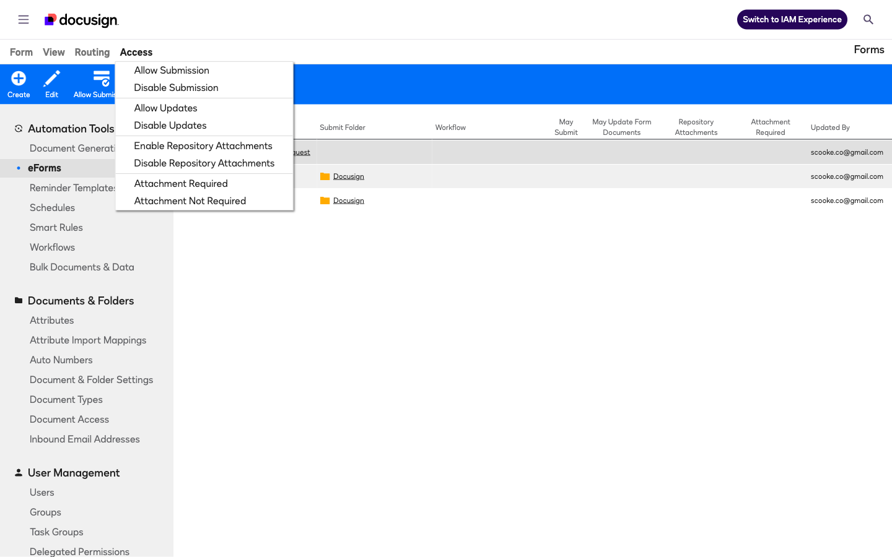

**What you pick:** the attribute field ids, when the HTML holds `REPLACE:<Group.Field>` placeholders: tick each
group the steps list in the picker, press **Generate Sample Form**, copy each field's `metadatafieldid` from the
generated `<springcm:MetaFieldInput …/>` tags into the `.html`, then clear the generated HTML and paste the
whole `.html`. The ids are the account's own: a bundle built for one account does not fit another.

**What to check after:**
- **Every Save of the form turns off Allow Submission and Allow Updates.** Turn them on again after each edit.
  An edit also applies to forms already submitted: they open with the new HTML.
- **Preview** shows every part of the form: its show-if rules and checks run only on the submit page (CLM raises
  its load event there, not in Preview).
- Submit it once: the folder gets `<form name>.sxform` with the attributes, and each attachment as its own
  document. The form answers (custom ids) are in the `.sxform` content, not in the attribute panel.
- Save As copies the HTML only, not the folder, workflow or access settings.

**Common errors:**
- A field shows "Unable to load file|/_Custom_/System Files/…": a dynamic drop-down attribute whose CSV is missing.
- A field is missing from the form: its attribute id is not in this account (a placeholder left, or another
  account's id).
- A form answer is empty in the workflow: read `CustomFormFields/<id>` in Params (letters and digits only), not
  an attribute.

## Agreement Desk settings

Not a file to upload: the `.desk-settings.json` lists account-wide settings and the `.md` beside it the clicks, all under
**Agreements ▸ Requests ▸ Settings** (an Agreement Desk admin). They change the desk for the whole account: agree them with its owner first.

- **Request types** ▸ the type ▸ **⋮ ▸ Set as default**: one default per account; the type must be active (imported first). Emailed requests get it.
- **Statuses** ▸ the status's handle ▸ **Move up** until it tops Open: new requests start in it.
- **Admin** ▸ **Agreement Desk AI** (recommends the type and fills the form) and **Disable "Send for Signature" when approvals are pending or rejected** (a confirm dialog).
- **Email**: the desk's own address (forward your team's contracts address to it) and the switches for people outside the account: submit requests by email, reply to request messages, real-time invites.
- **Notifications**: the submitter's confirmation and update emails; **Request submitted** ▸ add the users or groups to email (they need to manage requests) ▸ Save.

Check after: Request types shows "(Default)" after the type; each switch reads as set after a reload.

## AI agent

**There is no upload.** Agent Studio has no documented export or import. The bundle carries a build sheet (`.md`)
and the agent's API revision (`.revision.json`).

- **By hand:** Automations ▸ **Agents** (Agent Studio) ▸ **Create New**. The first dialog, "Create a draft agent",
  opens on a box that asks you to describe the agent; choose **Use classic editor** instead: that editor has the
  build sheet's fields. Fill in name, description, instructions, capabilities, the outputs a workflow reads. Then
  **Publish**. A hand-made agent gets a new key, so after the workflow import pick it again in each **Execute AI
  Agent** step: the step shows "Select" with no warning, and Review and Publish does not list it. (The editor's own
  Save draft also rewrites the author and the tool set.)
- **The name** takes letters, numbers and spaces only ("Agent names can only contain letters, numbers, and
  spaces"): for a test copy use a prefix such as `ZZ Test `, not `ZZ Test · `.
<!-- repo -->
- **By the deploy:** `captures/deploy-scenario.ts --solution=<manifest>` creates the agent by API from the
  revision under the key the workflow names, so nothing needs re-picking.
<!-- /repo -->

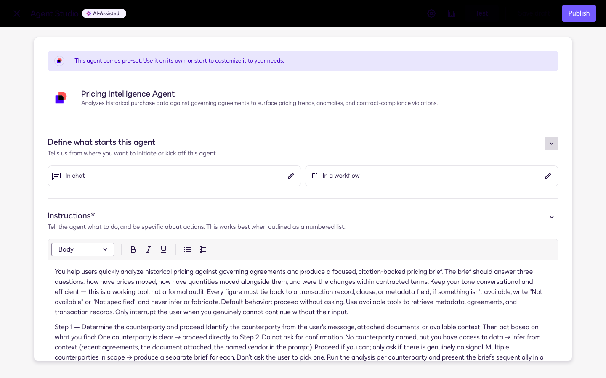

(Screen from the gallery, legacy account. No agent was created for this page: each create counts against the
account's quota.)

**Before you start:** an account holds at most 100 agents, drafts and deleted agents included. The Agents list does
not show deleted agents, so it can look like there is room when there is none. At the limit **Save draft** says
only "Something went wrong. Please try again."; the answer behind it is `403` "Tenant resource quota exceeded for
'agent'. Current: 100, limit: 100" (seen 2026-11-01). Nothing is created. Ask Docusign support to raise the limit. Agent Studio needs IAM Professional, Enterprise,
for Sales or Platform, "AI assistant and Agent Studio" (on demo still "Iris agent capabilities") on in AI Control Settings, the plan item Enable Agreement Manager (without it Automations ▸ Agents is missing; only
Docusign can turn it on), and a U.S. or Canadian account.

**What to check after:** the agent is **published** and shared with the people who run the workflow. Knowledge
files are uploaded by hand and can never be deleted from the account.

## Salesforce envelope templates

**There is no file upload.** An eSignature for Salesforce envelope template is Salesforce records
(`dfsle__EnvelopeConfiguration__c` and one `dfsle__EnvelopeConfigurationRecipient__c` per signer role) that point
at an eSignature template by its id (`dfsle__DocuSignId__c`); the documents and tabs come from that template.

<!-- repo -->
**The deploy does it:** `DEPLOY_LAB=1 captures/deploy-scenario.ts --solution=<manifest>` creates each library
eSignature template of the manifest (`POST /templates`) and, for one with a `salesforce` block, inserts its records
as one sObject Tree request (`POST /services/data/v62.0/composite/tree/dfsle__EnvelopeConfiguration__c`, compiled
by `salesforceEnvelopeConfig` in `src/esign-template-spec.ts`, with `DocuSignId__c` = the new template). It goes
through the signed-in Salesforce host profile (`src/salesforce-rest.ts`; `npm run host-login -- salesforce` once).
Every record is ledgered; `captures/park-scenario.ts` deletes them by id after checking the configuration's name.
Proven on 2026-10-30 with `mutual-nda-salesforce` (the lab account + the Developer Edition org): template
created, configuration and two recipient records inserted, listed in Salesforce as not a draft, then parked.
<!-- /repo -->

**What you pick:** nothing. The order matters: the eSignature template exists first, because the records name its
id. The bundle README marks an eSignature template with a Salesforce block and links here.

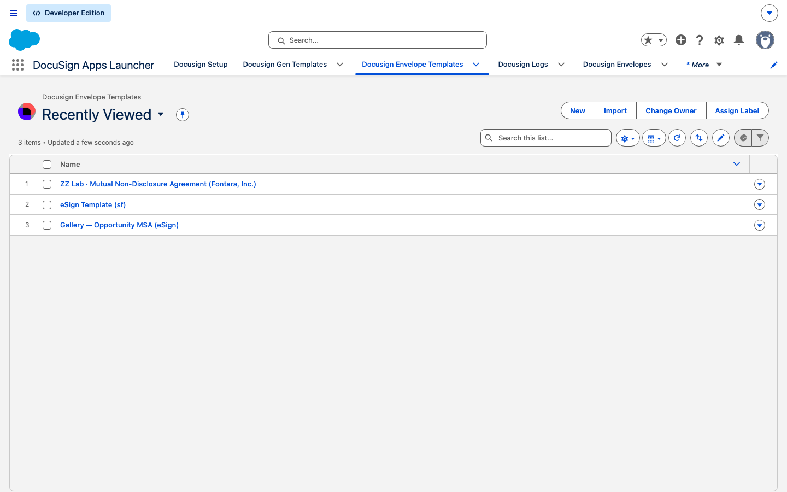

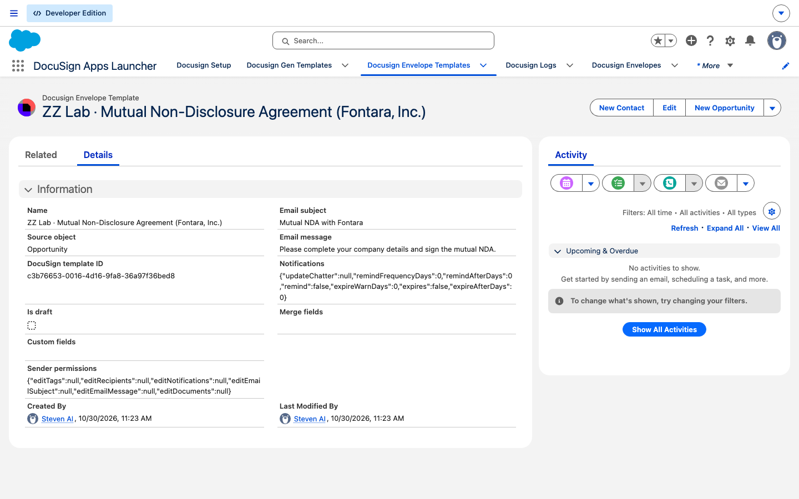

**What to check after:** the template is listed under Docusign Envelope Templates, its record shows the eSignature
template's id and **Is draft** unticked (inserted without `dfsle__IsDraft__c: false`, a configuration is a draft;
the compiler writes `false`). Every Salesforce field and related list it names must exist in the org. The list's own **Import**
button was not tried.

**To send from a record you need a button.** The sending page opens only from a custom button on the source
object's page layout (opened directly it refuses: "This page requires a CSRF confirmation token"). A spec with
`salesforce.button` gets one from the deploy (a Metadata API deploy of a WebLink); by hand, open the template in
Salesforce ▸ the wizard's last step (Custom Button). Either way, add the button to the page layout yourself
(Setup ▸ Object Manager ▸ <object> ▸ Page Layouts ▸ Buttons). Proven 2026-10-31: from
a ZZ Lab Opportunity, the page loaded the template's document, found the counterparty through the contact-role lookup,
made the sender the Fontara signer, and made a draft envelope (not sent).

## Lookup table

A **Use Data from a Table** step reads a CSV that is an **account document**, not part of the package. The bundle
carries it beside the workflow package as `lookup-table-<table>.csv`, and the package's step names a placeholder.

- **By hand:** after the workflow import, open the draft, click the **Use Data from a Table** step. It says "Failed
  to load the previously saved document. Please upload the file again." Click **Upload** (CSV or XLSX), choose
  the bundle's `lookup-table-<table>.csv`, then **Next** through Columns and the match conditions (3 steps), and
  set them as the README says. **Save and Close**.
<!-- repo -->
- **By the deploy:** `captures/deploy-scenario.ts --solution=<manifest>` uploads each CSV first (reserve, upload,
  claim: `src/lookup-table.ts`) and compiles the workflow with the new document id, so the imported step is
  ready.
<!-- /repo -->

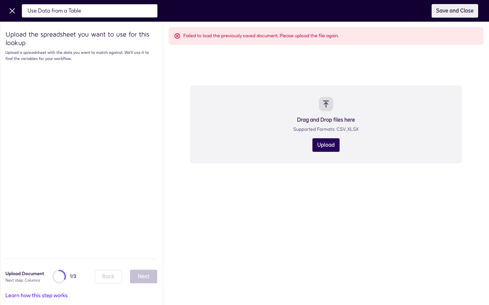

(The screen is the step of `deal-region-routing` right after an import; the CSV was not uploaded, so nothing
permanent was left.)

**For good:** no known call deletes an uploaded table document, so each upload of a lookup CSV stays in the
account.

## Bulk send

A template the README marks "Sent in bulk" comes with a recipient list, `<template file>.bulk-send.csv`: the
header and one example row. Bulk send is not stored in the template. A person starts it when sending, and
eSignature sends **one envelope per row** (at most 999 rows).

**The list (CSV):**
- `<Role>::Name` and `<Role>::Email` for every recipient role of the template.
- `<Role>::Host Name` and `<Role>::Host Email` for an in-person signer.
- `<Role>::<label>` for each field the list fills (the template's field tab labels). A checkbox takes a capital
  `X`; a date with validation starts with an apostrophe (`'06/01/2027`).
- `<Role>::PaymentAmount` when the template's payment amount is filled per envelope.
- `<Role>::<label>` for each number tab a computed payment amount reads (e.g. `Customer::Balance`).
- For a document template: `Document Generation::<field label>` per sender field (every required field needs a value
  in every row) and `Dynamic Table::<table>|<column>` per table column, with `|` between the table's rows in a cell.
- The example row uses test inboxes (`zz-lab.…@example.com`): replace it with your rows.

**Click path (eSignature template):** Start ▸ **Envelopes** ▸ **Use a Template** ▸ the uploaded template ▸ in
**Add recipients**, **Bulk send** ▸ **Upload a file** ▸ **Next** ▸ choose the CSV ▸ **Save**. Then **Send**.

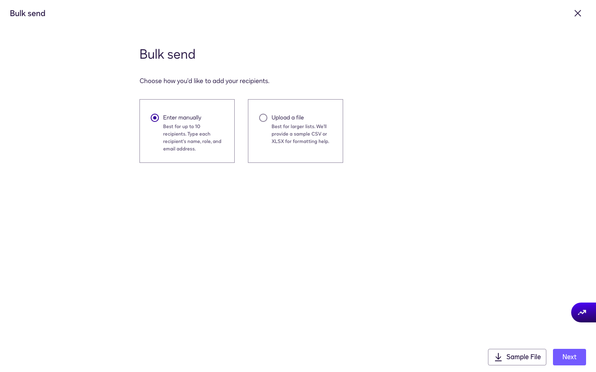

**Click path (document template):** Templates ▸ Use Template has no bulk option. Start ▸ **Envelopes** ▸ **Send
Envelope** ▸ Add documents ▸ **Upload** ▸ **Document Templates** ▸ the published template ▸ **Add Selected**; then in
**Add recipients**, **Bulk send** ▸ **Upload a file** ▸ choose the CSV. The import may list `<role>::Signature
Provider` as a matching exception: **Accept** it (it is optional) ▸ **Save** ▸ **Next** (the document still shows the
`{{field}}` syntax; the values go in when it is sent) ▸ **Send**. The list fills the sender fields: no "Add field
data" form opens. Bulk send takes one document template, with at most 100 sender fields.

**What you pick:** nothing. The column names must match the template exactly. **Sample File** in the same dialog
downloads the columns this envelope expects: compare it with the bundle's header if an upload reports errors.

**What to check after:** Agreements ▸ **Bulk Send** lists the batch with its progress ("2 of 2 sent");
**Summary** opens its envelopes.

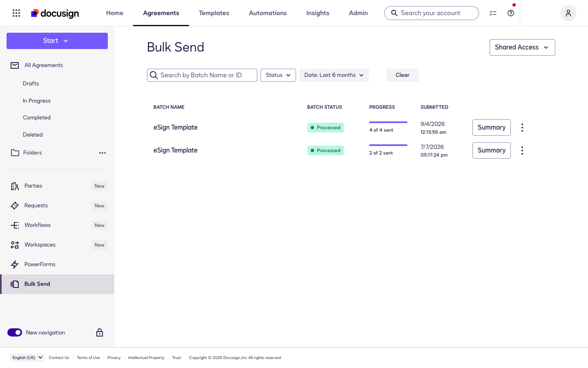

**Common errors:**
- A column whose role or label is not on the template: the upload lists it under **Errors**.
- A role name with `( ) : ; < > @`, or a label with a comma or a period: the list cannot be read.
- An authentication setting that needs the recipient to have a Docusign account: the list does not import.

## Agreement Manager: Track obligations

**Not an upload: an account setting.** A new account starts with obligation tracking off. Agreement Manager then
finds no obligations in your agreements and none of the newer AI fields (for example Line of Business, Party Role,
the HR fields). A bundle with an agent that works on obligations lists it under its prerequisites. Workflows
that read the standard agreement fields (dates, parties, agreement type) do not need it.

**How to tell:** Agreements ▸ **Completed**. While tracking is off, the page header shows a **Track obligations**
button next to **AI-Assisted**. When it is on, the button is gone.

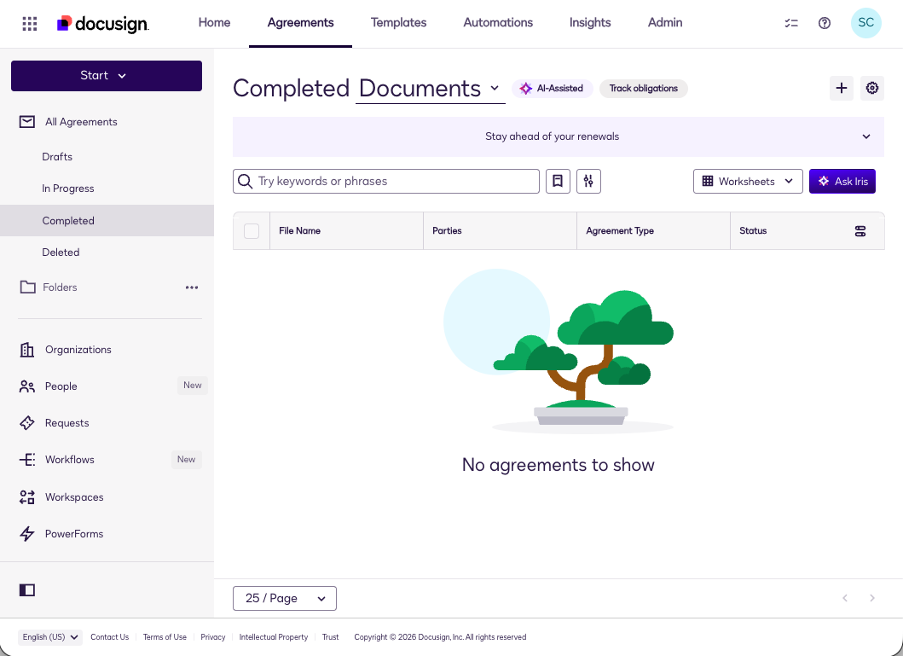

(Test 1, a new account, 2026-11-02. the owner's screen; the button was not clicked.)

**Click path:** **Track obligations** ▸ **Start Now** ▸ turn on **Process for additional insights** ▸ **Save
Changes**. A message says your agreements are being processed for additional AI insights
([help](https://support.docusign.com/s/document-item?language=en_US&bundleId=pqz1702943441912&topicId=rsz1722973735168.html)).

**Before you click:** it cannot be turned off, and processing cannot be stopped. It processes your agreements again,
and obligations are found in English (U.S.) agreements only.
<!-- repo -->
**Read-only check:** `GET {region}/devx-iam/v1/accounts/{accountId}/settings` (the app's own call):
`settings.aiExtractions.extendedAiExtractionsEnabled` and `obligationsAiExtractionsEnabled`. The app shows the
button while either is false; its opt-in sets both to true. `deploy-scenario` prints the result as "now on" or
"now OFF" (src/deploy-preflight.ts need `track-obligations`). On 2026-11-02: Test 1 both false; the lab account
and a second lab account both true.
<!-- /repo -->

**What to check after:** the **Track obligations** button is gone; an agreement's **Obligations** pane lists what
was found once processing ends.
